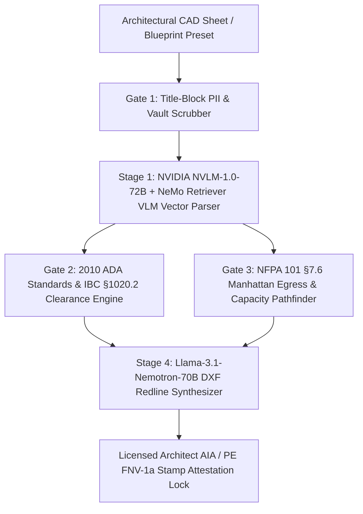

# System Architecture — BlueprintSight VL

## Module Breakdown
1. **`src/lib/blueprint/floorplan-cad-extractor.ts`**: 4 commercial/institutional blueprints (`BP-MED-101`, `BP-STEM-204`, `BP-HOSP-309`, `BP-IND-412`), deterministic PII/security vault scrubber, and pure-memory What-If override engine.
2. **`src/lib/compliance/ada-accessibility-engine.ts`**: Evaluates ADA §304.3.1 (`60"` turning circle), §404.2.3 (`32"` clear door), §403.5.1 / IBC §1020.2 (`36"`/`44"` corridor), and §404.2.4 (`18"` pull latch clearance).
3. **`src/lib/egress/nfpa101-egress-pathfinder.ts`**: Computes Manhattan travel vectors, NFPA 13 sprinklered vs. unsprinklered travel limits, common path of travel, dead-end corridor limits, and IBC §1005.3.2 occupant exit capacity.
4. **`src/lib/nebius/nebius-nemotron-vl-supervisor.ts`**: Orchestrates the 4-stage Nebius AI Studio / NVIDIA NIM pipeline with a `4.5s` `AbortController` circuit breaker and AIA/PE stamp attestation hashing.

## Nebius Token Factory & buildingSMART IFC.JSON 4.3 (`nebius-nemotron-vl-supervisor.ts`)
- **Nebius Token Factory Endpoint**: `https://api.tokenfactory.us-central1.nebius.com/v1/chat/completions` with `response_format.json_schema.strict = true`.
- **BIM Interoperability**: `buildIfcJsonComplianceExport()` emits `IFC.JSON` `4.3.2.0` (`IFC4X3_ADD2`) `IfcProject` + `IfcSpace` objects with `Pset_Ada2010Accessibility` and `Pset_Nfpa101LifeSafetyEgress`.
